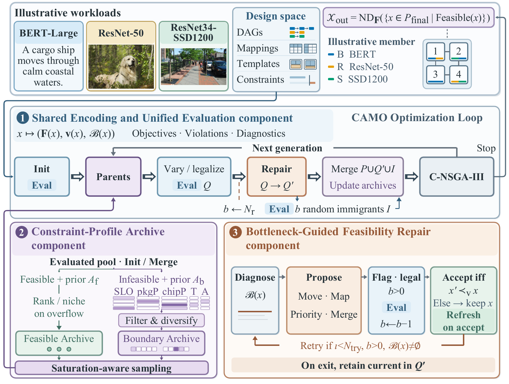

# CAMO

**Constraint-Aware Multi-Objective Co-Optimization for Multi-DNN Workloads on Chiplet-Based Accelerators**

CAMO jointly optimizes hardware configuration, layer mapping, chiplet placement, and scheduling for design-time-known multi-DNN batches. It combines shared evaluation, complementary constraint-profile archives, and bottleneck-guided feasibility repair with constrained NSGA-III selection.

This repository accompanies the ACM TACO manuscript of the same title. It contains the C++ implementation, workload graphs, experiment configurations, preserved results, and reproducibility tools.



## Start here

| Goal | Entry point |
|---|---|
| Verify the artifact | `python scripts/check_artifact.py` |
| Rebuild descriptive tables and Figure 2 source values | `python scripts/reproduce_results.py` |
| Plot Figure 2 from those values | `python scripts/plot_figure2.py` |
| Build and test the optimizer | [Build and run](#build-and-run) |
| Recompute the 660-run sensitivity analysis from raw CSVs | [Full raw-data analysis](docs/REPRODUCING.md#full-raw-data-analysis) |
| Find files behind a paper result | [Paper-to-artifact map](docs/PAPER_MAP.md) |

The first two commands require only Python 3.8+. They leave preserved inputs unchanged and write regenerated files under `outputs/`.

```bash
python scripts/check_artifact.py
python scripts/reproduce_results.py
```

For statistical reanalysis and plotting, install the recorded analysis dependencies in an isolated environment:

```bash
python -m venv .venv
source .venv/bin/activate
python -m pip install -r requirements-analysis.txt
python scripts/plot_figure2.py
```

See [Reproducing the results](docs/REPRODUCING.md) for input layouts and commands.

## Implementation and reproducibility

The design space instantiates up to **eight chiplets** from the **Simba** template library; every instantiated chiplet hosts at least one layer. CAMO retains MOHaM's joint representation, architecture negotiation, and genetic operators.

Timeloop/Accelergy supplies mapping-level cycles, accesses, energy, and area. The capacity-aware scheduler and compact RC model use these costs to evaluate complete multi-DNN designs. The five minimization objectives are total energy, batch makespan, aggregate chiplet silicon area, peak temperature, and worst-tenant completion/deadline ratio.

CAMO has three components:

1. **Shared Encoding and Unified Evaluation component:** one legal joint-design representation and one evaluator returning objectives, normalized violations, and bottleneck diagnostics.
2. **Constraint-Profile Archive component:** feasible and boundary archives retain complementary information for saturation-aware parent sampling.
3. **Bottleneck-Guided Feasibility Repair component:** diagnostics guide typed local proposals; admissible proposals are re-evaluated and accepted on constraint-profile improvement.

The effective violation profile contains SLO, package power, chiplet power, temperature, and area. Bandwidth capacity is enforced by scheduling. Implementation conventions and version identities are recorded in [Versions](docs/VERSIONS.md) and [Data dictionary](docs/DATA_DICTIONARY.md).

### Default fixed-evaluation settings

These are the full-CAMO defaults used for RQ1, RQ2, and RQ4. Explicit ablations and controls override the corresponding settings.

| Parameter | Setting |
|---|---:|
| Mapping pre-search: generations / population / immigrants | 5 / 120 / 20 |
| Joint search: generations / population / auxiliary evaluations per generation | 10 / 250 / 25 |
| Reference-direction partitions | 4 |
| Feasible / boundary archive capacity | 40 / 40 |
| Boundary-parent probability / decay exponent | 0.10 / 4 |
| Repair trigger probability / maximum attempts | 0.60 / 2 |
| Reference adaptation / service-stretch attribution | Disabled |
| Simulated clock / thermal step | 1 GHz / 100,000 cycles |

A run evaluates 250 random initial designs and re-evaluates two heuristic seeds. Each of ten generations then evaluates 250 offspring and shares 25 auxiliary evaluations between repair and random immigrants:

```text
250 + 2 + 10 × (250 + 25) = 3,002 true evaluations
```

Evaluated repair proposals consume this shared allowance even when rejected. Remaining allowance evaluates immigrants; every offspring retains its current record, including unchanged offspring.

The original RQ3 family instead uses a common **900-second evaluation-admission cutoff**, with in-flight evaluations completing normally. Its six reference-direction partitions and 125/125 archive capacities are preserved separately from the fixed-evaluation defaults.

## Build and run

The optimizer targets GNU/Linux. The recorded environment uses GCC 9.4.0, CMake 3.16.3, Python 3.8.10, Timeloop, and Accelergy. Timeloop source is included under `lib/timeloop/`; its recorded revision and the Accelergy/plugin revisions are in `provenance/dependencies.json` and `docker/Dockerfile`.

Build a dependency image from the preserved recipe:

```bash
docker build -f docker/Dockerfile -t camo:paper .
docker run --rm -v "$PWD:/workspace" -w /workspace camo:paper \
  bash -lc 'cmake -S . -B build -DCMAKE_BUILD_TYPE=Release && cmake --build build -j3 && ctest --test-dir build --output-on-failure'
```

Run a portable CAMO configuration from the repository root:

```bash
docker run --rm -v "$PWD:/workspace" -w /workspace -e OMP_NUM_THREADS=3 camo:paper \
  bash -lc './build/moham configs/normal.yaml -o outputs/normal-seed101'
```

Portable configurations cover Normal, SLO-tight, Temperature-tight, Power-tight, Holdout-2, and Normal 900 seconds. They retain the recorded scientific parameters while rebasing asset paths and using a fresh mapping-cache directory. The first run performs mapping pre-search when that cache is absent. Original configurations remain under `configs/recorded/`.

For a lightweight C++ check independent of Timeloop/Accelergy installation:

```bash
g++ -std=c++14 -O2 -I src tests/nsga3_selection_smoke.cc -o /tmp/camo-selection-test
/tmp/camo-selection-test
```

## Results and raw data

Result families remain separate because they use family-specific reference fronts and normalization:

- `results/primary-*`: four five-method Edge-3 comparisons, 30 paired seeds per method.
- `results/ablation`, `results/equal-cost`, `results/temperature-control`: component and control studies.
- `results/wallclock`: the original five-method 900-second comparison.
- `results/holdout2`, `results/mobile3`, `results/datacenter4*`: transfer and supplementary studies.
- `results/thermal-audit`: the selected 60-design RC/HotSpot comparison.
- `results/ctaea-sensitivity`: the final selected 660-run mating-rule study, comprising 649 retained runs and 11 accepted replacements.

Each result directory provides per-seed metrics, summaries, and paired tests where available. Recorded method identifiers are retained; their CAMO aliases are explained in the data dictionary.

The raw sensitivity CSVs are distributed separately as **`camo-ctaea-sensitivity-raw-v1.zip`**, with a matching SHA-256 file. Obtain the matching asset from this repository's [Releases](https://github.com/achuan2/camo-chiplet-optimization/releases), then:

```bash
python scripts/check_raw_release.py /path/to/camo-ctaea-sensitivity-raw-v1.zip
python -m zipfile -e /path/to/camo-ctaea-sensitivity-raw-v1.zip .
python scripts/reanalyze_sensitivity.py --raw data/raw/ctaea-sensitivity \
  --output outputs/sensitivity-reanalysis
```

The archive contains the evaluation ledger, final-population metrics, and evaluation timing for each selected run. `provenance/raw-release.json` identifies its checksum and layout. Raw data and generated outputs are excluded from ordinary Git tracking.

## Repository layout

```text
src/                    C++ optimizer and evaluator
lib/timeloop/           Preserved Timeloop source dependency
experiments/            Architecture components and workload graphs
configs/                Portable examples and recorded configurations
scripts/                Verification, reconstruction, plotting, and original tools
results/                Preserved, family-specific processed results
analysis/reference/     Recorded sensitivity-analysis source and plan
snapshots/              Retained fixed-budget and wall-clock source excerpts
provenance/             File identities, versions, selection, and family catalog
docs/                   Reproduction guide, paper map, and data dictionary
```

`MANIFEST.sha256` verifies the released repository contents. `.gitattributes` preserves the byte identity of frozen inputs across Windows and Linux checkouts.

## Attribution and citation

CAMO builds on [MOHaM](https://github.com/Haimrich/moham) by Abhijit Das, Enrico Russo, and Maurizio Palesi. The original MIT license is retained. Timeloop retains its own license. See [third-party notices](THIRD_PARTY.md).

When using CAMO, cite the accompanying manuscript **“Constraint-Aware Multi-Objective Co-Optimization for Multi-DNN Workloads on Chiplet-Based Accelerators”** and acknowledge MOHaM:

```bibtex
@article{moham2024,
  author  = {Das, Abhijit and Russo, Enrico and Palesi, Maurizio},
  title   = {Multi-Objective Hardware-Mapping Co-Optimisation for Multi-DNN Workloads on Chiplet-Based Accelerators},
  journal = {IEEE Transactions on Computers},
  year    = {2024},
  volume  = {73},
  number  = {8},
  pages   = {1883--1898},
  doi     = {10.1109/TC.2024.3386067}
}
```

